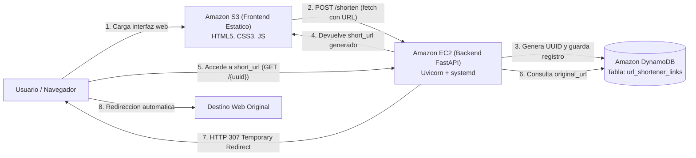

# Acortador de Enlaces Cloud (AWS S3 + EC2 + DynamoDB)


Servicio web en la nube desplegado sobre Amazon Web Services (AWS) para el acortamiento y redireccionamiento de enlaces URL. La arquitectura implementa generacion dinamica de identificadores unicos mediante UUID v4, persistencia NoSQL en Amazon DynamoDB, API REST desarrollada con FastAPI en Amazon EC2 (ejecutada mediante Uvicorn y gestionada por systemd) e interfaz web estatica alojada en Amazon S3.

---

## Tabla de Contenidos
1. [Arquitectura del Sistema](#arquitectura-del-sistema)
2. [Estructura del Repositorio](#estructura-del-repositorio)
3. [Especificacion de la API REST (FastAPI)](#especificacion-de-la-api-rest-fastapi)
4. [Ejecucion y Pruebas Locales](#ejecucion-y-pruebas-locales)
5. [Guia de Despliegue en AWS](#guia-de-despliegue-en-aws)
   - [5.1 Amazon DynamoDB](#51-configuracion-de-amazon-dynamodb)
   - [5.2 Rol y Politica IAM para EC2](#52-creacion-del-rol-iam-para-la-instancia-ec2)
   - [5.3 Amazon EC2 (Backend FastAPI)](#53-lanzamiento-y-configuracion-de-amazon-ec2)
   - [5.4 Administracion del Servicio con systemd](#54-administracion-del-servicio-con-systemd)
   - [5.5 Amazon S3 (Frontend Estatico)](#55-despliegue-del-frontend-en-amazon-s3)
   - [5.6 Verificacion de la Integracion](#56-verificacion-de-la-integracion)

---

## Arquitectura del Sistema



---

## Estructura del Repositorio

```text
aws-url-shortener/
├── backend/
│   ├── app/
│   │   ├── __init__.py
│   │   ├── config.py             # Configuracion y lectura de variables de entorno
│   │   ├── db.py                 # Conexion Boto3 a DynamoDB (IAM Instance Profile)
│   │   ├── models.py             # Modelos de datos y validaciones con Pydantic
│   │   └── main.py               # Endpoints REST, CORS y logica de redireccion
│   ├── service/
│   │   ├── setup-ec2.sh          # Script de aprovisionamiento automatico para EC2
│   │   └── urlshortener.service  # Unidad systemd para ejecucion persistente
│   ├── tests/
│   │   └── test_api.py           # Suite de pruebas automatizadas con pytest
│   ├── .env.example              # Plantilla de variables de entorno del backend
│   └── requirements.txt          # Dependencias de Python (FastAPI, Uvicorn, Boto3)
├── frontend/
│   ├── index.html                # Interfaz de usuario HTML5 semantica
│   ├── styles.css                # Hoja de estilos responsiva
│   ├── app.js                    # Logica del cliente con Fetch API y visor de metadatos
│   └── config.js                 # Configuracion de la direccion base del backend
├── .gitignore
└── README.md                     # Documentacion tecnica de instalacion y despliegue
```

---

## Especificacion de la API REST (FastAPI)

### Endpoint 1: Crear enlace corto
- **Metodo:** `POST`
- **Ruta:** `/shorten`
- **Codigo de Respuesta:** `HTTP 201 Created`
- **Cuerpo de la Solicitud (JSON):**
  ```json
  {
    "original_url": "https://www.example.com/articulos/arquitectura-cloud"
  }
  ```
- **Respuesta Exitosa (JSON):**
  ```json
  {
    "short_code": "550e8400-e29b-41d4-a716-446655440000",
    "original_url": "https://www.example.com/articulos/arquitectura-cloud",
    "short_url": "http://<ip-publica-ec2>:8000/550e8400-e29b-41d4-a716-446655440000"
  }
  ```

### Endpoint 2: Redireccionar al destino original
- **Metodo:** `GET`
- **Ruta:** `/{short_code}`
- **Parametro de ruta:** `short_code` (UUID v4 del enlace)
- **Comportamiento:** Redireccion HTTP nativa (`HTTP 307 Temporary Redirect`) hacia la direccion `original_url`.
- **Respuesta en caso de no existir:** `HTTP 404 Not Found`.

### Endpoint 3: Consultar metadatos de un enlace
- **Metodo:** `GET`
- **Ruta:** `/urls/{short_code}`
- **Codigo de Respuesta:** `HTTP 200 OK`
- **Respuesta Exitosa (JSON):**
  ```json
  {
    "short_code": "550e8400-e29b-41d4-a716-446655440000",
    "original_url": "https://www.example.com/articulos/arquitectura-cloud",
    "created_at": "2026-10-29T21:30:00.000000+00:00"
  }
  ```
- **Respuesta en caso de no existir:** `HTTP 404 Not Found`.

---

## Ejecucion y Pruebas Locales

### 1. Backend
```bash
cd backend
python -m venv venv

# En Linux/macOS:
source venv/bin/activate
# En Windows (PowerShell):
.\venv\Scripts\Activate.ps1

pip install -r requirements.txt pytest httpx
```

Ejecutar las pruebas unitarias:
```bash
python -m pytest tests/ -v
```

Ejecutar el servidor local en modo desarrollo con el CLI oficial de FastAPI:
```bash
fastapi dev app/main.py --host 0.0.0.0 --port 8000
```
*(Tambien puedes ejecutar `fastapi dev` directamente dentro de la carpeta `backend`, ya que FastAPI detecta automaticamente `app/main.py` y levanta el servidor con auto-reload en el puerto 8000).*
- API REST: `http://localhost:8000`
- Documentacion interactiva Swagger UI: `http://localhost:8000/docs`

### 2. Frontend
Abrir `frontend/index.html` en el navegador o iniciar un servidor web estatico:
```bash
cd frontend
python -m http.server 3000
```
Acceder a `http://localhost:3000`.

---

## Guia de Despliegue en AWS

### 5.1 Configuracion de Amazon DynamoDB
1. Acceder al servicio **DynamoDB** en la consola de AWS y hacer clic en **Create table**.
2. Parametros requeridos:
   - **Table name:** `url_shortener_links`
   - **Partition key:** `short_code` (Tipo: **String**)
   - **Sort key:** No requerida.
   - **Table settings:** Seleccionar **Customize settings** > **On-demand** (Bajo demanda) para optimizar costos de facturacion.
3. Hacer clic en **Create table** y esperar a que el estado sea **Active**.

---

### 5.2 Creacion del Rol IAM para la Instancia EC2
Para garantizar la seguridad de la infraestructura sin almacenar credenciales en texto claro, la instancia EC2 adquiere credenciales temporales mediante un perfil de instancia IAM.

1. Acceder a **IAM** > **Policies** > **Create policy**.
2. Seleccionar la pestana **JSON** y definir la politica con el principio de menor privilegio:
   ```json
   {
     "Version": "2012-10-17",
     "Statement": [
       {
         "Sid": "DynamoDBTableAccess",
         "Effect": "Allow",
         "Action": [
           "dynamodb:PutItem",
           "dynamodb:GetItem"
         ],
         "Resource": "arn:aws:dynamodb:*:*:table/url_shortener_links"
       }
     ]
   }
   ```
3. Nombrar la politica como `URLShortenerDynamoDBPolicy` y guardar.
4. Ir a **IAM** > **Roles** > **Create role**.
5. Seleccionar **AWS service**, caso de uso **EC2**.
6. Adjuntar la politica `URLShortenerDynamoDBPolicy`.
7. Nombrar el rol como `EC2-URLShortener-Role` y crearlo.

---

### 5.3 Lanzamiento y Configuracion de Amazon EC2

#### 1. Security Group
Crear un Security Group llamado `url-shortener-sg` con las siguientes reglas de entrada (Inbound rules):
- **SSH (TCP 22):** Origen restringido a la IP de administracion o `0.0.0.0/0`.
- **Custom TCP (Puerto 8000):** Origen `0.0.0.0/0` (Trafico web hacia la API de FastAPI).

#### 2. Lanzar Instancia
- **Nombre:** `URL-Shortener-Backend`
- **AMI:** Ubuntu Server 24.04 LTS o 22.04 LTS.
- **Tipo de instancia:** `t2.micro` o `t3.micro`.
- **Security Group:** `url-shortener-sg`.
- **IAM instance profile (Detalles avanzados):** Asignar `EC2-URLShortener-Role`.

#### 3. Instalacion y Puesta en Marcha
Conectarse por SSH a la instancia:
```bash
ssh -i "clave.pem" ubuntu@<IP_PUBLICA_EC2>
```

Clonar el repositorio:
```bash
git clone https://github.com/A-Krycek/10.-Midterm---Practical.git aws-url-shortener
cd aws-url-shortener/backend
```

**Metodo A: Instalacion Automatizada (Recomendado)**
```bash
bash service/setup-ec2.sh
```
El script detecta la IP publica de la instancia, instala dependencias del sistema operativo, prepara el entorno virtual, genera el archivo `.env` y configura el servicio persistente en `systemd`.

**Metodo B: Instalacion Manual**
```bash
sudo apt update && sudo apt install -y python3 python3-pip python3-venv git
python3 -m venv venv
source venv/bin/activate
pip install -r requirements.txt

cat <<EOF > .env
AWS_REGION=us-east-1
DYNAMODB_TABLE_NAME=url_shortener_links
BASE_URL=http://<IP_PUBLICA_EC2>:8000
CORS_ORIGINS=*
EOF

sudo cp service/urlshortener.service /etc/systemd/system/
sudo systemctl daemon-reload
sudo systemctl enable urlshortener
sudo systemctl start urlshortener
```

---

### 5.4 Administracion del Servicio con systemd
`systemd` supervisa la aplicacion en segundo plano y gestiona reinicios automaticos:

```bash
# Consultar estado del servicio
sudo systemctl status urlshortener

# Reiniciar el servicio
sudo systemctl restart urlshortener

# Visualizar registros de actividad en tiempo real
sudo journalctl -u urlshortener -f
```

---

### 5.5 Despliegue del Frontend en Amazon S3

#### 1. Configuracion de la direccion del Backend
Editar `frontend/config.js` para indicar la direccion publica del backend:
```javascript
const APP_CONFIG = {
  API_BASE_URL: "http://<IP_PUBLICA_EC2>:8000"
};
```
*(La aplicacion tambien permite modificar esta direccion en tiempo de ejecucion mediante la interfaz web).*

#### 2. Crear Bucket S3 y Habilitar Alojamiento Web
1. Crear un bucket en S3 (ejemplo: `acortador-enlaces-cloud-prod`).
2. Desmarcar la opcion **Block all public access** y confirmar el consentimiento.
3. En la pestana **Properties**, habilitar **Static website hosting**:
   - Index document: `index.html`.
   - Copiar el endpoint web generado (formato: `http://<bucket>.s3-website-<region>.amazonaws.com`).

#### 3. Politica de Acceso Publico del Bucket
En la pestana **Permissions** > **Bucket policy**, configurar la lectura publica de los objetos:
```json
{
  "Version": "2012-10-17",
  "Statement": [
    {
      "Sid": "PublicReadGetObject",
      "Effect": "Allow",
      "Principal": "*",
      "Action": "s3:GetObject",
      "Resource": "arn:aws:s3:::NOMBRE_DE_TU_BUCKET/*"
    }
  ]
}
```

#### 4. Carga de Archivos
Cargar en la raiz del bucket los archivos de la carpeta `frontend/`:
- `index.html`
- `styles.css`
- `app.js`
- `config.js`

---

### 5.6 Verificacion de la Integracion
1. Acceder al endpoint web de S3 en el navegador.
2. Comprobar que el indicador de estado confirme conexion activa con el backend en EC2.
3. Introducir una URL valida en el formulario y solicitar la creacion del enlace corto (`POST /shorten`).
4. Verificar en la consola de DynamoDB la insercion del registro con sus atributos `short_code`, `original_url` y `created_at`.
5. Copiar el enlace corto generado y abrirlo en una nueva pestana del navegador para comprobar la redireccion automatica HTTP 307.
6. Consultar los metadatos del enlace utilizando el identificador UUID generado (`GET /urls/{short_code}`).
7. Verificar que las solicitudes a identificadores inexistentes retornen el codigo `404 Not Found`.
