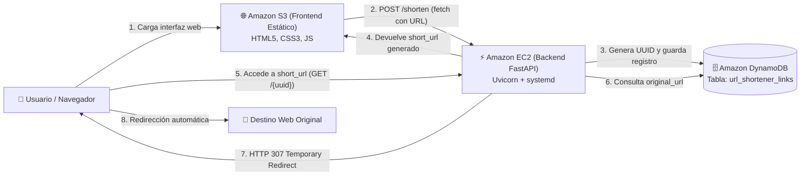

# Acortador de Enlaces Cloud (AWS S3 + EC2 + DynamoDB)


Solución integral y desplegada en la nube de Amazon Web Services (AWS) para un servicio acortador de enlaces web. La aplicación implementa generación dinámica de identificadores únicos mediante UUID, persistencia NoSQL en Amazon DynamoDB, API REST de alto rendimiento con FastAPI en Amazon EC2 (gestionada por systemd) y frontend responsivo alojado en Amazon S3.

---

## Arquitectura de la Solución



---

## Estructura del Repositorio

```text
aws-url-shortener/
├── backend/
│   ├── app/
│   │   ├── __init__.py
│   │   ├── config.py             # Configuración y lectura de variables de entorno
│   │   ├── db.py                 # Conexión a DynamoDB con Boto3 (IAM Instance Profile)
│   │   ├── models.py             # Esquemas de datos y validaciones con Pydantic
│   │   └── main.py               # Instancia de FastAPI, CORS y endpoints REST
│   ├── service/
│   │   └── urlshortener.service  # Unidad systemd para persistencia en Linux EC2
│   ├── tests/
│   │   └── test_api.py           # Pruebas automatizadas con pytest y TestClient
│   ├── .env.example              # Plantilla de variables de entorno del backend
│   └── requirements.txt          # Dependencias de Python
├── frontend/
│   ├── index.html                # Interfaz de usuario estructurada
│   ├── styles.css                # Estilos modernos y responsivos
│   ├── app.js                    # Lógica con fetch(), validaciones y copia
│   └── config.js                 # Configuración de endpoint del backend en EC2
├── docs/
│   ├── AWS_SETUP_GUIDE.md        # Paso a paso de DynamoDB, IAM, EC2 y S3
│   ├── SYSTEMD_SETUP.md          # Configuración y administración de systemd
│   └── VIDEO_DEMO_SCRIPT.md      # Guion y checklist para el video de entrega
├── .gitignore
└── README.md
```

---

## Especificación de la API REST (FastAPI)

### 1. Crear un enlace corto
- **Método:** `POST`
- **Ruta:** `/shorten`
- **Cuerpo de la Solicitud (JSON):**
  ```json
  {
    "original_url": "https://www.example.com/articulos/arquitectura-cloud"
  }
  ```
- **Respuesta Exitosa (HTTP 201 Created):**
  ```json
  {
    "short_code": "550e8400-e29b-41d4-a716-446655440000",
    "original_url": "https://www.example.com/articulos/arquitectura-cloud",
    "short_url": "http://<ip-publica-ec2>:8000/550e8400-e29b-41d4-a716-446655440000"
  }
  ```

### 2. Redireccionar al destino original
- **Método:** `GET`
- **Ruta:** `/{short_code}`
- **Parámetro:** `short_code` (UUID del enlace)
- **Comportamiento:** Redirección HTTP real (`307 Temporary Redirect`) hacia la `original_url`.
- **En caso de no existir:** `HTTP 404 Not Found`.

### 3. Consultar metadatos de un enlace
- **Método:** `GET`
- **Ruta:** `/urls/{short_code}`
- **Respuesta Exitosa (HTTP 200 OK):**
  ```json
  {
    "short_code": "550e8400-e29b-41d4-a716-446655440000",
    "original_url": "https://www.example.com/articulos/arquitectura-cloud",
    "created_at": "2026-10-29T21:30:00.000000+00:00"
  }
  ```
- **En caso de no existir:** `HTTP 404 Not Found`.

---

## Ejecución y Pruebas Locales

### 1. Backend
```bash
cd backend
python -m venv venv

# En Linux/macOS:
source venv/bin/activate
# En Windows (PowerShell):
.\venv\Scripts\Activate.ps1

pip install -r requirements.txt
```

Ejecutar las pruebas unitarias:
```bash
python -m pytest -v
```

Ejecutar el servidor localmente:
```bash
uvicorn app.main:app --reload --host 0.0.0.0 --port 8000
```
La documentación interactiva estará disponible en `http://localhost:8000/docs`.

### 2. Frontend
Abre el archivo `frontend/index.html` en tu navegador o levanta un servidor estático rápido:
```bash
cd frontend
python -m http.server 3000
```
Accede a `http://localhost:3000`.

---

## Guías de Despliegue en AWS

Para desplegar los tres servicios en la nube, consulta las guías dedicadas incluidas en el proyecto:
- [Guía de Despliegue en AWS (DynamoDB, IAM, EC2, S3)](docs/AWS_SETUP_GUIDE.md)
- [Guía del Servicio systemd en Linux](docs/SYSTEMD_SETUP.md)
- [Guion para el Video de Demostración y Evaluación](docs/VIDEO_DEMO_SCRIPT.md)
