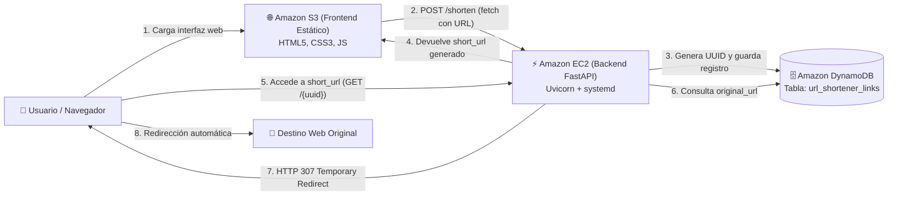

# Acortador de Enlaces Cloud (AWS S3 + EC2 + DynamoDB)


Solución integral y desplegada en la nube de Amazon Web Services (AWS) para un servicio acortador de enlaces web. La aplicación implementa generación dinámica de identificadores únicos mediante UUID, persistencia NoSQL en Amazon DynamoDB, API REST de alto rendimiento con FastAPI en Amazon EC2 (gestionada por systemd) y frontend responsivo alojado en Amazon S3.

---

## Tabla de Contenidos
1. [Arquitectura de la Solución](#arquitectura-de-la-solución)
2. [Estructura del Repositorio](#estructura-del-repositorio)
3. [Especificación de la API REST (FastAPI)](#especificación-de-la-api-rest-fastapi)
4. [Ejecución y Pruebas Locales](#ejecución-y-pruebas-locales)
5. [Guía de Despliegue en AWS (Paso a Paso)](#guía-de-despliegue-en-aws-paso-a-paso)
   - [5.1 Amazon DynamoDB](#51-configuración-de-amazon-dynamodb)
   - [5.2 Rol y Política IAM para EC2](#52-creación-del-rol-iam-para-la-instancia-ec2-mínimo-privilegio)
   - [5.3 Amazon EC2 (Backend FastAPI)](#53-lanzamiento-y-configuración-de-amazon-ec2)
   - [5.4 Servicio Persistente con systemd](#54-configuración-y-administración-del-servicio-systemd)
   - [5.5 Amazon S3 (Frontend Estático)](#55-despliegue-del-frontend-en-amazon-s3)
   - [5.6 Verificación de Integración de los 3 Servicios](#56-verificación-de-integración-de-los-3-servicios)
6. [Guion y Checklist para el Video de Demostración (8/8 Puntos)](#guion-y-checklist-para-el-video-de-demostración)

---

## Arquitectura de la Solución



---

## Estructura del Repositorio

```text
aws-url-shortener/
├── backend/
│   ├── app/
│   │   ├── __init__.py
│   │   ├── config.py             # Configuración y variables de entorno
│   │   ├── db.py                 # Conexión Boto3 a DynamoDB con IAM Instance Profile
│   │   ├── models.py             # Esquemas de datos y validaciones Pydantic
│   │   └── main.py               # Endpoints REST, CORS y manejo de redirecciones
│   ├── service/
│   │   ├── setup-ec2.sh          # Script de auto-despliegue en 1 solo comando en EC2
│   │   └── urlshortener.service  # Unidad systemd para persistencia en Linux
│   ├── tests/
│   │   └── test_api.py           # 7 pruebas automatizadas con pytest (100% pasando)
│   ├── .env.example              # Plantilla de variables de entorno del backend
│   └── requirements.txt          # Dependencias de Python (FastAPI, Uvicorn, Boto3)
├── frontend/
│   ├── index.html                # Interfaz de usuario estructurada sin frameworks
│   ├── styles.css                # Estilos modernos y responsivos con tema AWS
│   ├── app.js                    # Consumo de API con fetch(), copiado y visor JSON
│   └── config.js                 # Configuración de endpoint del backend en EC2
├── .gitignore
└── README.md                     # Documentación integral, guías de AWS y guion de video
```

---

## Especificación de la API REST (FastAPI)

### Endpoint 1: Crear un enlace corto
- **Método:** `POST`
- **Ruta:** `/shorten`
- **Código de Respuesta:** `HTTP 201 Created`
- **Cuerpo de la Solicitud (JSON):**
  ```json
  {
    "original_url": "https://www.example.com/articulos/arquitectura-cloud"
  }
  ```
- **Respuesta Exitosa (JSON):**
  ```json
  {
    "short_code": "550e8400-e29b-41d4-a716-446655440000",
    "original_url": "https://www.example.com/articulos/arquitectura-cloud",
    "short_url": "http://<ip-publica-ec2>:8000/550e8400-e29b-41d4-a716-446655440000"
  }
  ```

### Endpoint 2: Redireccionar al destino original
- **Método:** `GET`
- **Ruta:** `/{short_code}`
- **Parámetro:** `short_code` (UUID del enlace)
- **Comportamiento:** Redirección HTTP real (`HTTP 307 Temporary Redirect`) hacia la `original_url`.
- **En caso de no existir:** `HTTP 404 Not Found`.

### Endpoint 3: Consultar metadatos de un enlace
- **Método:** `GET`
- **Ruta:** `/urls/{short_code}`
- **Código de Respuesta:** `HTTP 200 OK`
- **Respuesta Exitosa (JSON):**
  ```json
  {
    "short_code": "550e8400-e29b-41d4-a716-446655440000",
    "original_url": "https://www.example.com/articulos/arquitectura-cloud",
    "created_at": "2026-10-29T21:30:00.000000+00:00"
  }
  ```
- **En caso de no existir:** `HTTP 404 Not Found`.

---

## Ejecución y Pruebas Locales

### 1. Backend
```bash
cd backend
python -m venv venv

# En Linux/macOS:
source venv/bin/activate
# En Windows (PowerShell):
.\venv\Scripts\Activate.ps1

pip install -r requirements.txt pytest httpx
```

Ejecutar las 7 pruebas unitarias automatizadas:
```bash
python -m pytest tests/ -v
```

Ejecutar el servidor localmente:
```bash
uvicorn app.main:app --reload --host 0.0.0.0 --port 8000
```
- API y endpoints: `http://localhost:8000`
- Documentación interactiva Swagger: `http://localhost:8000/docs`

### 2. Frontend
Abre el archivo `frontend/index.html` directamente en tu navegador o levanta un servidor estático rápido:
```bash
cd frontend
python -m http.server 3000
```
Accede a `http://localhost:3000`.

---

## Guía de Despliegue en AWS (Paso a Paso)

### 5.1 Configuración de Amazon DynamoDB
1. Inicia sesión en la **Consola de Administración de AWS**.
2. Dirígete a **DynamoDB** y haz clic en **Create table** (Crear tabla).
3. Configura los siguientes parámetros:
   - **Table name:** `url_shortener_links`
   - **Partition key:** `short_code` (Tipo: **String**)
   - **Sort key:** *Dejar en blanco (no se requiere).*
   - **Table settings:** Selecciona **Customize settings** y elige **On-demand** (Bajo demanda) para optimizar costos de la capa gratuita.
4. Haz clic en **Create table** y espera a que el estado sea **Active**.

---

### 5.2 Creación del Rol IAM para la Instancia EC2 (Mínimo Privilegio)
Para cumplir con las mejores prácticas de seguridad en la nube (sin guardar credenciales ni llaves estáticas en el código), la instancia EC2 usará un rol IAM con credenciales temporales gestionadas por Boto3.

1. Ve a **IAM** > **Policies** > **Create policy**.
2. Cambia a la pestaña **JSON** y pega la siguiente política de privilegios mínimos:
   ```json
   {
     "Version": "2012-10-17",
     "Statement": [
       {
         "Sid": "DynamoDBTableAccess",
         "Effect": "Allow",
         "Action": [
           "dynamodb:PutItem",
           "dynamodb:GetItem"
         ],
         "Resource": "arn:aws:dynamodb:*:*:table/url_shortener_links"
       }
     ]
   }
   ```
3. Nómbrala `URLShortenerDynamoDBPolicy` y haz clic en **Create policy**.
4. En el menú de IAM, ve a **Roles** > **Create role**.
5. Selecciona **AWS service**, caso de uso **EC2**, haz clic en **Next**.
6. Busca y selecciona la política `URLShortenerDynamoDBPolicy`.
7. Nombra el rol como `EC2-URLShortener-Role` y haz clic en **Create role**.

---

### 5.3 Lanzamiento y Configuración de Amazon EC2

#### Crear el Security Group
1. Ve a **EC2** > **Security Groups** > **Create security group**.
2. Nombre: `url-shortener-sg`.
3. En **Inbound rules** (Reglas de entrada):
   - **SSH (Puerto 22):** Origen `My IP` o `0.0.0.0/0`.
   - **Custom TCP (Puerto 8000):** Origen `0.0.0.0/0` (Para permitir el tráfico del frontend en S3 y los navegadores).
4. Haz clic en **Create security group**.

#### Lanzar la Instancia EC2
1. En **EC2**, haz clic en **Launch instances**:
   - **Name:** `URL-Shortener-Backend`
   - **AMI:** `Ubuntu Server 24.04 LTS` o `Ubuntu Server 22.04 LTS`.
   - **Instance type:** `t2.micro` o `t3.micro`.
   - **Key pair:** Tu par de llaves `.pem`.
   - **Network settings:** Selecciona `url-shortener-sg`.
   - **Advanced details > IAM instance profile:** Selecciona **`EC2-URLShortener-Role`** *(Indispensable para el acceso a DynamoDB)*.
2. Haz clic en **Launch instance** y copia la **Dirección IP pública IPv4** (ej: `54.210.45.67`).

#### Configuración del Backend en EC2 (Vía SSH)
Conéctate por SSH a la instancia:
```bash
ssh -i "tu-llave.pem" ubuntu@<IP_PUBLICA_EC2>
```

Clona el repositorio:
```bash
git clone https://github.com/A-Krycek/10.-Midterm---Practical.git aws-url-shortener
cd aws-url-shortener/backend
```

**Opción A: Despliegue Automatizado en 1 comando (Recomendado)**
```bash
bash service/setup-ec2.sh
```
*El script detecta la IP pública, instala paquetes del sistema, prepara el entorno virtual, crea el archivo `.env` y configura el servicio persistente `systemd`.*

**Opción B: Despliegue Manual Paso a Paso**
```bash
sudo apt update && sudo apt install -y python3 python3-pip python3-venv git
python3 -m venv venv
source venv/bin/activate
pip install -r requirements.txt

# Crear archivo .env
cat <<EOF > .env
AWS_REGION=us-east-1
DYNAMODB_TABLE_NAME=url_shortener_links
BASE_URL=http://<IP_PUBLICA_EC2>:8000
CORS_ORIGINS=*
EOF

# Configurar servicio systemd
sudo cp service/urlshortener.service /etc/systemd/system/
sudo systemctl daemon-reload
sudo systemctl enable urlshortener
sudo systemctl start urlshortener
```

---

### 5.4 Configuración y Administración del Servicio systemd
El servicio `systemd` garantiza que el backend se ejecute en segundo plano, no se detenga al cerrar la terminal SSH y se reinicie automáticamente ante cualquier fallo:

```bash
# Consultar estado del servicio
sudo systemctl status urlshortener

# Reiniciar servicio
sudo systemctl restart urlshortener

# Ver registros en tiempo real (Logs)
sudo journalctl -u urlshortener -f
```

---

### 5.5 Despliegue del Frontend en Amazon S3

#### 1. Preparar archivo de configuración local
Antes de subir los archivos, abre `frontend/config.js` y asigna la IP pública de tu EC2:
```javascript
const APP_CONFIG = {
  API_BASE_URL: "http://<IP_PUBLICA_EC2>:8000"
};
```
*(Nota: La interfaz web también cuenta con un botón en pantalla "⚙️ Cambiar Host EC2" para cambiar la IP al vuelo en cualquier momento).*

#### 2. Crear el Bucket en S3
1. Ve a **S3** > **Create bucket**.
2. Nombre: `acortador-enlaces-<tu-nombre>-midterm` (único globalmente).
3. **Desmarca** la casilla `Block all public access` y marca el recuadro de consentimiento.
4. Haz clic en **Create bucket**.

#### 3. Habilitar Alojamiento Web Estático (Static Website Hosting)
1. Entra al bucket > Pestaña **Properties** > Baja hasta **Static website hosting** > **Edit**.
2. Selecciona **Enable**.
3. **Index document:** `index.html`.
4. Haz clic en **Save changes** y copia la **URL del sitio web** generada (ej: `http://<bucket>.s3-website-us-east-1.amazonaws.com`).

#### 4. Configurar la Política de Acceso Público al Bucket
1. En el bucket, ve a la pestaña **Permissions** > **Bucket policy** > **Edit**.
2. Pega la siguiente política reemplazando `NOMBRE_DE_TU_BUCKET`:
   ```json
   {
     "Version": "2012-10-17",
     "Statement": [
       {
         "Sid": "PublicReadGetObject",
         "Effect": "Allow",
         "Principal": "*",
         "Action": "s3:GetObject",
         "Resource": "arn:aws:s3:::NOMBRE_DE_TU_BUCKET/*"
       }
     ]
   }
   ```
3. Guarda los cambios.

#### 5. Subir los archivos del Frontend
En la pestaña **Objects**, sube los 4 archivos de la carpeta `frontend/`:
- `index.html`
- `styles.css`
- `app.js`
- `config.js`

---

### 5.6 Verificación de Integración de los 3 Servicios
1. Abre la URL de S3 en el navegador.
2. Verifica que el indicador de estado del Backend EC2 aparezca en color verde (Online).
3. Ingresa una URL original (ej: `https://aws.amazon.com/dynamodb/`) y pulsa **Acortar URL**:
   - Se genera el UUID dinámico y se compone el enlace corto `http://<IP_EC2>:8000/<UUID>`.
4. Ve a la consola de DynamoDB y comprueba el nuevo registro con `short_code`, `original_url` y `created_at`.
5. Haz clic en **Copiar**, abre una nueva pestaña del navegador, pega el enlace corto y presiona Enter: **comprueba la redirección HTTP 307 automática**.
6. En la sección de consulta del frontend, ingresa el UUID y pulsa **Consultar** para verificar los metadatos JSON (`GET /urls/{short_code}`).
7. Ingresa un UUID inexistente y comprueba el error `404 Not Found`.

---

## Guion y Checklist para el Video de Demostración

> **Duración recomendada:** 5 a 8 minutos.  
> **Puntaje Objetivo:** 8 / 8 Puntos Posibles.

### 1. Introducción y Repositorio (0:00 - 1:00)
- **Pantalla:** Repositorio en GitHub abierto y estructura modular en VS Code.
- **Puntos clave:**
  - "Buenas, en este video presento el desarrollo y despliegue del acortador de enlaces cloud utilizando la arquitectura integrada de AWS: Amazon S3 (Frontend), Amazon EC2 (FastAPI con Uvicorn y systemd) y Amazon DynamoDB (persistencia NoSQL)."
  - "El proyecto está organizado modularmente separando backend, frontend, pruebas automatizadas y configuración por variables de entorno."

### 2. Demostración de Servicios en la Consola de AWS (1:00 - 2:30)
- **DynamoDB:** Mostrar la tabla `url_shortener_links` con Partition Key `short_code` (String).
- **Rol IAM:** Mostrar el rol `EC2-URLShortener-Role` con la política de mínimo privilegio (`dynamodb:PutItem`, `dynamodb:GetItem`). Destacar: *"No hay credenciales duras en el código; Boto3 usa credenciales temporales vía Instance Profile"*.
- **EC2:** Mostrar la instancia en ejecución, Security Group (puertos 22 y 8000) y ejecutar en SSH `sudo systemctl status urlshortener`.
- **S3:** Mostrar el bucket con Static Website Hosting habilitado y los archivos subidos.

### 3. Pruebas Funcionales Integradas (2:30 - 5:30)
- **POST /shorten:** En la web de S3, ingresar una URL original y hacer clic en **Acortar URL**. Mostrar el enlace generado y refrescar DynamoDB para ver el nuevo registro creado.
- **GET /{short_code} (Redirección 307):** Copiar el enlace corto, abrirlo en una pestaña nueva y mostrar cómo el navegador navega automáticamente a la web original con código 307.
- **GET /urls/{short_code}:** En la sección de consulta, pegar el UUID y mostrar la respuesta JSON con `short_code`, `original_url` y `created_at`.
- **Validación y 404:** Ingresar un UUID inexistente para mostrar el error 404, y probar ingresar un texto no válido en el formulario para mostrar la validación.
- **Persistencia tras reinicio:** En la terminal de EC2, reiniciar el servicio con `sudo systemctl restart urlshortener` y demostrar que los enlaces siguen funcionando perfectamente.

### 4. Conclusión (5:30 - 6:00)
- Resumen final de la solución integrada y despedida.
